# Phase 2 T5 결과 풀이: 이미지를 "어떤 순서로 읽느냐"가 중요한가?

> 이 문서는 Mamba, 신호처리, 딥러닝을 처음 접하는 사람도 읽을 수 있도록 썼어요.
> 그림 파일은 모두 [`figures/`](figures/)에 있어요. 숫자는 모두 이 저장소의 스크립트로 다시 만들 수 있어요(맨 아래 "재현 방법").

---

## 0. 먼저 알아둘 용어

| 용어 | 쉬운 설명 |
|---|---|
| **스캔 순서** | 사진을 한 줄짜리 목록으로 바꾸는 규칙이에요. 책을 읽을 때 "왼쪽→오른쪽, 위→아래"로 읽는 것도 하나의 스캔 순서예요. 이 연구는 14×14 크기(픽셀 196개)의 옷 사진을 6가지 다른 순서로 읽어요. |
| **토큰 / 시퀀스** | 순서대로 늘어놓은 픽셀 하나하나가 토큰이고, 196개 토큰을 늘어놓은 목록 전체가 시퀀스예요. 모델은 이 목록을 한 칸씩 차례로 읽어요. |
| **Mamba** | 목록을 앞에서부터 한 칸씩 읽으면서 "지금까지 본 것"을 작은 메모장(상태)에 요약해 두는 모델이에요. 새 칸을 읽을 때마다 메모장을 얼마나 지우고 얼마나 새로 적을지를 **입력을 보고 스스로 정해요**(selective). 사람이 긴 글을 읽으며 중요한 부분만 기억하는 것과 비슷해요. |
| **causal convolution (d_conv=4)** | Mamba가 메모장에 적기 전에, **바로 앞의 3칸 + 지금 칸 = 4칸**을 한 번에 묶어 섞는 단계예요. "돋보기로 바로 옆 글자 몇 개를 같이 보는 것"에 가까워요. Mamba는 이런 층이 2개라 겹치면 최대 7칸까지 묶여요. |
| **receptive field** | 모델이 한 번에 "직접" 볼 수 있는 범위예요. 위의 4칸(1층)과 7칸(2층)이 Mamba conv의 범위예요. 메모장(상태)은 이보다 훨씬 먼 과거도 기억할 수 있어요. |
| **공간 점프** | 목록에서는 바로 옆 칸인데, 원래 사진에서는 서로 멀리 떨어진 두 픽셀 사이의 이동이에요. 예: 한 줄 끝(오른쪽)에서 다음 줄 처음(왼쪽)으로 넘어가는 것. |
| **주기성 / PSD** | 신호에서 같은 패턴이 일정 간격으로 반복되는 성질이 주기성이에요. PSD(파워 스펙트럼 밀도)는 "어떤 간격의 반복이 얼마나 강한지"를 보여 주는 그래프예요. 노래에서 베이스와 고음이 각각 얼마나 큰지 보여 주는 이퀄라이저 화면과 비슷해요. |
| **macro-F1** | 분류를 얼마나 잘했는지 나타내는 점수(0~1, 높을수록 좋음)예요. 10가지 옷 종류마다 점수를 따로 낸 뒤 평균하므로, 잘 틀리는 옷 종류도 똑같이 반영돼요. |
| **seed** | 모델 학습의 "주사위 시작값"이에요. 같은 설정이라도 seed가 다르면 결과가 조금씩 달라요. 그래서 seed 3개(0, 1, 2)로 학습해 차이가 우연인지 확인해요. |
| **검증 세트(validation)** | 학습에 쓰지 않고 따로 떼어 둔 이미지 12,000장이에요. 모든 성능 숫자는 여기서 쟀어요. 공식 테스트 세트는 팀이 평가 규칙을 확정하기 전까지 쓰지 않아요. |

---

## 1. 한 문단 요약

옷 사진(Fashion-MNIST)을 한 줄로 펴는 방법 6가지(Raster, Snake, Random, Blockwise, Spiral 바깥방향, Spiral 안쪽방향)를 비교했어요.
**모델 없이 신호만 분석한 결과**는 세 가지예요.
1. Mamba가 한 번에 묶어 보는 4칸 안에 "공간 점프"가 섞이는 비율이 스캔마다 크게 달라요(Snake·Spiral 0%, Raster 20%, Blockwise·Random 100%). 특히 Blockwise는 평균 이동 거리가 짧은데도 모든 묶음에 점프가 있어요.
2. Raster의 14칸 주기성은 줄바꿈 점프 때문이 아니라 **옷 사진 자체의 줄 구조**(양 끝은 배경, 가운데는 옷) 때문이에요. 점프가 없는 Snake도 거의 같은 주기성을 가져요.
3. Snake와 Spiral은 둘 다 점프가 전혀 없지만, Spiral은 옷이 있는 가운데부터 읽어서 **중요한 정보가 들어오는 시점**이 완전히 달라요.

**모델 결과**(검증 세트, seed 3개)는 이래요.
1. Mamba는 모든 스캔에서 0.86~0.875(macro-F1)였어요. **Snake가 가장 좋고(0.875), Random이 가장 나빴어요(0.860).** Random은 seed 3개 모두에서 Raster보다 낮았는데, 같은 비교에서 CNN은 차이가 없었어요. 사진을 뒤섞어 읽으면 **순서대로 기억을 쌓는 Mamba만** 손해를 봐요.
2. **같은 나선 경로를 반대로 읽으면 Mamba 성능이 달라졌어요.** 가장자리부터 읽는 Spiral (in)이 seed 3개 모두에서 가운데부터 읽는 (out)보다 높았어요(+0.006). 두 스캔은 신호 지표가 완전히 같으니, **읽는 방향 자체**가 Mamba에 영향을 준다는 증거예요. CNN에서는 이런 차이가 없었어요.
3. 다만 차이는 대부분 0.01 안팎으로 작아요. 신호 지표(점프 비율, 매끄러움, 주기성) 하나로는 성능 순서를 설명할 수 없었어요. 학습된 Mamba는 공간 점프보다 **지금 읽는 내용(배경인지 옷인지)**에 반응해 기억을 조절했어요(F16, F17).

---

## 1.5 Mamba 기본 원리 (발표 앞부분 필수 4항목)

> 그림 F16a·F17은 학습이 끝난 모델의 내부 값을 꺼내 본 것이에요. **Raster Mamba, seed 0 최종 체크포인트**(17 epoch, 검증 macro-F1 0.872)를 썼고, 검증 이미지 2,000장으로 계산했어요. 같은 분석을 Spiral (in) 모델로 해도 큰 그림은 같았어요(아래에 함께 적어요).

### ① 점화식과 EMA, 그리고 Δ의 의미와 한계

**점화식**: Mamba의 핵심 계산은 한 줄이에요.

> h_t = exp(Δ_t·A) · h_(t−1) + Δ_t · B_t · x_t,   y_t = C_t · h_t + D · x_t

말로 풀면 이래요. "지금 메모장(h_t) = 예전 메모장을 조금 지운 것 + 지금 입력을 조금 적은 것."

**EMA와의 연결**: 주식 차트의 이동평균선 같은 EMA(지수이동평균)는 `h_t = a·h_(t−1) + (1−a)·x_t`예요. a가 1에 가까우면 예전 값을 오래 기억하고, 0에 가까우면 금방 잊어요. Mamba의 `exp(Δ·A)`가 바로 이 a 역할을 해요.
- Phase 1 Task 1.3에서 이 대응(Δ = ln(a)/A)을 직접 계산했고, EMA 기억 길이가 길수록 HAR 분류 성능이 오르는 것도 확인했어요.
- 차이는 두 가지예요. ① Mamba는 a를 **토큰마다 입력을 보고 새로 정해요**(선택성). ② 채널마다 16개 상태가 서로 다른 A를 가져서, 짧은 기억부터 긴 기억까지 **EMA 여러 개를 동시에** 돌려요(필터 뱅크).

**F16a. 학습된 Δ가 말해 주는 것과 말해 주지 않는 것**
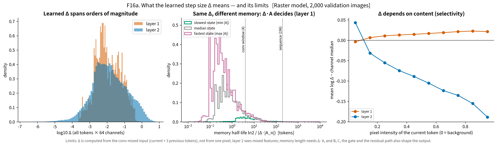
1. **왜 봤나**: "Δ가 크면 빨리 잊는다"는 해석이 실제 학습된 모델에서도 맞는지, 어디까지 믿을 수 있는지 확인하려고요.
2. **어떻게 읽나**:
   - 왼쪽: 모든 토큰·채널의 Δ 분포예요(가로축은 로그 눈금).
   - 가운데: 같은 Δ를 **가장 느린 상태 / 중간 상태 / 가장 빠른 상태**의 A와 곱했을 때의 기억 반감기(몇 토큰 뒤에 절반으로 줄어드는지)예요. 점선은 conv 창(4칸)과 전체 길이(196칸)예요.
   - 오른쪽: 지금 읽는 픽셀의 밝기(0 = 배경)에 따라 Δ가 얼마나 달라지는지예요.
3. **무엇이 보이나**:
   - **왼쪽**: Δ의 중앙값은 1층 0.009, 2층 0.012예요. 하위 5%와 상위 5%는 1층이 0.0009~0.18(약 200배), 2층이 0.0004~0.65(약 1,800배)예요. 모델이 토큰과 채널마다 Δ를 아주 다르게 쓴다는 뜻이에요.
   - **가운데**: 같은 Δ를 써도 기억 반감기(중앙값)는 상태마다 크게 달라요.
     - 가장 느린 상태: **68칸**
     - 중간 상태: **9칸**
     - 가장 빠른 상태: **4.3칸**
     - 그러니까 대부분의 상태는 몇 칸에서 수십 칸 안에 잊고, 196칸 전체를 기억하는 상태는 드물어요. Raster에서 68칸은 약 5줄이에요.
   - **오른쪽**:
     - **2층**은 밝은 픽셀(옷)을 읽을수록 Δ가 뚜렷하게 작아져요. 배경과 가장 밝은 픽셀의 차이는 약 0.23이에요(자연로그 기준이라 Δ가 약 0.8배가 돼요). 옷 위에서는 기억을 더 오래 붙잡는다는 뜻이에요.
     - **1층**은 채널을 평균하면 거의 평평해요. 하지만 이건 채널마다 반대 방향으로 반응해서 평균에서 상쇄된 것이에요. F17의 1층 채널 11처럼 개별 채널은 강하게 반응해요.
   - **Spiral (in) 모델과 비교**: Spiral (in) 모델로 같은 분석을 해도 결과가 같았어요. 2층이 옷 위에서 Δ를 낮추고, 반감기는 3~55칸이에요. 스캔과 상관없이 모델이 같은 전략을 배웠다는 뜻이에요.
4. **그래서 무슨 뜻인가**: Δ는 "얼마나 빨리 잊을지"를 정하는 **입력에 따라 바뀌는 다이얼**이에요. 하지만 같은 Δ라도 상태마다 실제 기억 길이가 약 16배 달라요(68칸 대 4.3칸). 그래서 기억 길이를 말하려면 Δ가 아니라 **Δ·A**를 봐야 해요.
5. **주의할 점(한계)**:
   - Δ는 픽셀 하나가 아니라 **conv로 섞인 4칸**을 보고 계산돼요.
   - 2층의 Δ는 픽셀이 아니라 1층이 만든 특징을 보고 정해져요.
   - 출력에는 B(얼마나 적을지), C(얼마나 읽을지), 게이트, residual도 함께 작용해요. 그래서 Δ 하나만 보고 모델 동작을 설명할 수는 없어요.

### ② Mamba 블록의 구조
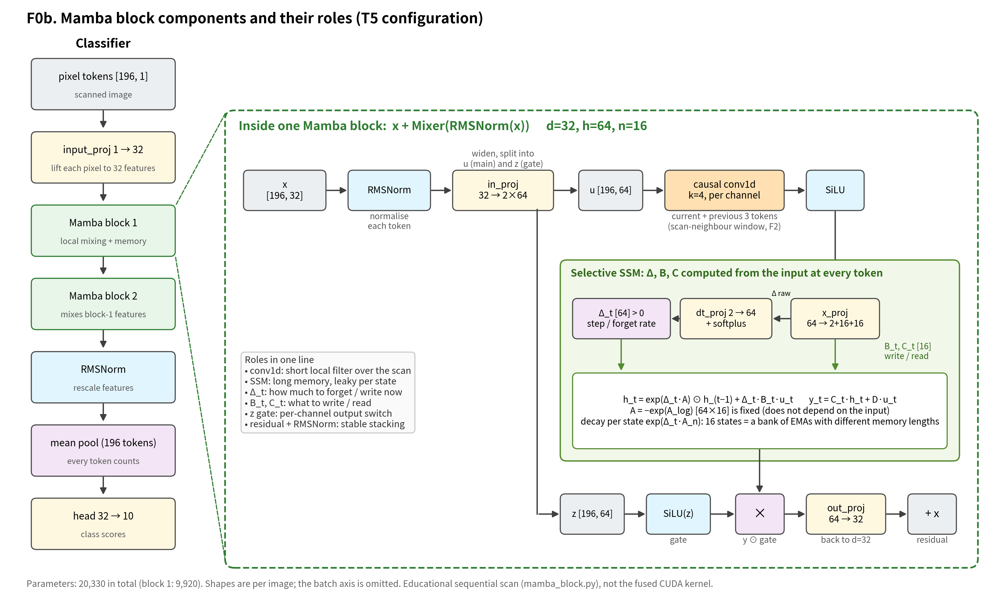
| 구성 요소 | 하는 일 (한 줄) |
|---|---|
| input_proj (1→32) | 픽셀 밝기 숫자 하나를 32개 특징으로 펼쳐요 |
| RMSNorm | 토큰마다 크기를 맞춰 학습을 안정시켜요 |
| in_proj (32→2×64) | 폭을 넓히고 **u(본 경로)**와 **z(게이트)** 두 갈래로 나눠요 |
| causal conv1d (k=4) | 지금 칸과 바로 앞 3칸을 섞는 **짧은 국소 필터**예요(스캔 이웃이 중요한 이유, F2) |
| SiLU | 부드러운 비선형 함수예요 |
| x_proj → Δ, B, C | 지금 입력을 보고 **얼마나 잊을지(Δ), 얼마나 적을지(B), 얼마나 읽을지(C)**를 정해요 |
| Selective SSM | 위 점화식으로 196칸을 차례로 읽으며 **긴 기억**을 유지해요 |
| SiLU(z) 게이트 ⊙ | 채널마다 출력을 얼마나 내보낼지 조절하는 스위치예요 |
| out_proj (64→32) + residual | 원래 폭으로 되돌리고 입력을 더해 층을 안정적으로 쌓아요 |
| mean pool → head | 196칸 출력을 **모두 평균**한 뒤 10개 옷 종류로 분류해요 |

Phase 1 Task 1.5에서 이 순서대로 손으로 다시 계산해 실제 모델 출력과 오차 0으로 일치하는 것을 확인했어요. 전체 파라미터는 20,330개예요.

### ③ LTI SSM과 Selective SSM: 합성곱 관점의 차이
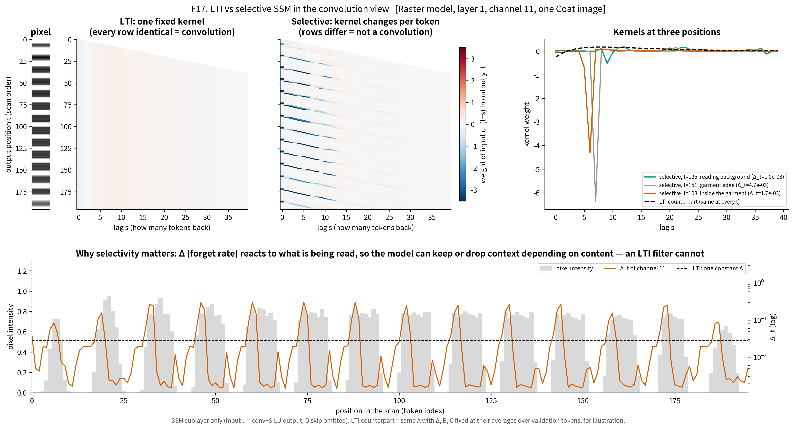
1. **왜 봤나**: "Δ, B, C가 고정된 SSM(LTI)은 사실상 합성곱이고, Selective SSM은 아니다"를 눈으로 보여 주려고요.
2. **어떻게 읽나**:
   - 왼쪽 세로 막대: 이미지를 스캔 순서로 편 픽셀 밝기예요.
   - 가운데 두 히트맵: 행 = 출력 위치 t, 열 = 몇 칸 전 입력인지(lag s), 색 = 그 입력이 지금 출력에 주는 가중치예요.
     - **LTI**: 모든 행이 똑같아요. 같은 필터를 미끄러뜨리는 합성곱이라는 뜻이에요.
     - **Selective**: 행마다 모양이 달라요.
   - 오른쪽 위: 배경 / 옷 가장자리 / 옷 안쪽을 읽는 시점의 커널을 LTI 커널(점선)과 비교해요.
   - 아래: 한 채널의 Δ_t(주황, 로그)와 픽셀 밝기(회색)를 겹친 그래프예요. 점선은 LTI라면 쓸 고정 Δ예요.
3. **무엇이 보이나** (Raster 모델, 1층 채널 11, Coat 이미지 한 장):
   - **아래 그래프**: 이 채널의 Δ는 대부분 0.002 정도로 아주 작아요. 그런데 **각 줄에서 옷이 시작되는 순간**(배경에서 옷으로 넘어가는 칸)에만 약 0.3으로 100배 넘게 튀어요.
     - Δ가 작다 = 메모장을 거의 안 건드리고 기억을 붙잡는다.
     - Δ가 크다 = 지금 칸을 강하게 적는다.
     - 즉 이 채널은 "이번 줄에서 옷이 어디서 시작했나"를 적어 두고, 그 줄의 나머지를 읽는 동안 들고 가요.
   - **가운데 히트맵(Selective)**: 오른쪽 아래로 뻗는 **파란 빗금**이 보여요. 줄마다 옷이 시작된 칸 하나가 그 뒤 약 10칸의 출력에 계속 영향을 준다는 뜻이에요.
   - **LTI 히트맵**: 모든 행이 같고 거의 평평해요.
   - **오른쪽 위**: 세 시점의 커널은 모두 **가장 최근 칸이 아니라 5~9칸 전**(그 줄에서 옷이 시작된 칸)에 큰 가중치가 있어요. 무엇을 기억할지를 내용이 정한다는 뜻이에요.
   - LTI 짝(점선)은 시점과 상관없이 같은 완만한 모양이라 이런 구분을 못 해요.
4. **그래서 무슨 뜻인가**: LTI는 내용과 상관없이 **항상 같은 필터**예요. Selective는 **무엇을 읽고 있느냐에 따라 필터를 바꿔요**. 이게 선택성이 중요한 이유예요. 배경처럼 쓸모없는 구간은 흘려보내고 중요한 내용은 오래 들고 갈 수 있어요.
5. **주의할 점**:
   - SSM 부분만의 커널이에요(입력은 conv+SiLU를 거친 값, D 경로 제외).
   - "LTI 짝"은 같은 A에 Δ, B, C를 평균값으로 고정해 만든 **설명용 비교 대상**이에요. 실제로 LTI로 학습한 모델이 아니에요.

### ④ 우리 연구 질문과의 연결
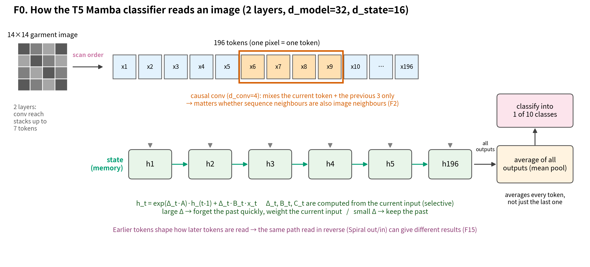
| 기본 원리 | 스캔 순서 연구에서의 의미 | 해당 그림 |
|---|---|---|
| causal conv는 **스캔상 이웃 4칸**만 섞어요 | 그 4칸이 사진에서도 이웃인지가 스캔마다 달라요(Snake·Spiral 0%, Raster 20%, Blockwise 100% 점프) | F2, F14(효정 d_conv ablation) |
| SSM은 **앞에서부터 차례로** 기억을 쌓아요(causal) | 같은 경로라도 읽는 방향이 다르면 결과가 달라질 수 있어요 | F6, F15(Spiral out vs in) |
| Δ는 **내용을 보고** 잊을지 말지를 정해요 | 스캔 점프 직후에 모델이 기억을 리셋하는지, 배경 구간을 흘려보내는지 확인할 수 있어요 | F16b |
| 출력은 **모든 칸의 평균** | "마지막에 본 영역"이 아니라 "앞 내용이 뒤 해석에 주는 영향"이 핵심이에요 | F0 |

**F16b. 학습된 모델은 어디서 Δ를 올리나 (스캔별 비교)**
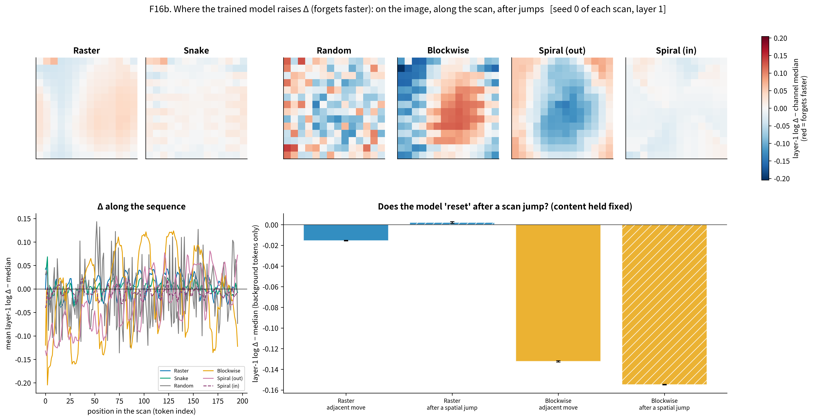
1. **왜 봤나**: 스캔 순서가 모델 내부의 "잊기" 패턴을 어떻게 바꾸는지 보려고요.
2. **어떻게 읽나**:
   - 위: 스캔별로 1층 Δ(채널 중앙값 대비)를 원래 사진 위치에 되돌려 놓은 지도예요. 빨강일수록 빨리 잊어요.
   - 왼쪽 아래: 스캔 순서를 따라 본 Δ예요.
   - 오른쪽 아래: **배경 → 배경 이동만** 골라서, 공간 점프 직후 토큰과 이웃 이동 토큰의 Δ를 비교해요. 내용(밝기)을 같게 맞춰서 점프 효과만 보려는 거예요.
3. **무엇이 보이나**:
   - **위 지도**:
     - Raster·Snake·Spiral (in)은 사진 전체에서 Δ가 고르게 퍼져 있어요(옅은 색).
     - Blockwise는 사진 가운데(옷)에서 Δ가 높고 가장자리에서 낮아요.
     - Spiral (out)은 반대로 가운데가 낮아요.
     - Random은 위치마다 들쭉날쭉해요.
     - 모델마다 Δ를 쓰는 방식이 꽤 달라요.
   - **오른쪽 아래(점프 직후 리셋?)**: 배경→배경 이동만 비교했어요.
     - Raster: 점프 직후 Δ가 이웃 이동보다 약간 높아요(+0.017).
     - Blockwise: 오히려 낮아요(−0.023).
     - 방향이 서로 반대이고 크기도 작아요.
4. **그래서 무슨 뜻인가**: 점프 직후 Δ가 올라가면 "모델이 공간 불연속을 알아채고 기억을 리셋한다"는 근거가 돼요. 하지만 그런 일관된 리셋은 **보이지 않았어요.** 모델은 점프 자체보다 지금 읽는 **내용(배경인지 옷인지)**에 반응해요(F16a, F17).
5. **주의할 점**: seed 0 모델 하나씩만 봐요. 그리고 모델마다 Δ의 절대 크기는 비교할 수 없어서, 채널 중앙값 대비 값으로 비교해요.

---

## 2. 모델 없이 본 신호 분석 (학습 이미지 60,000장)

### F1. 6가지 읽는 순서
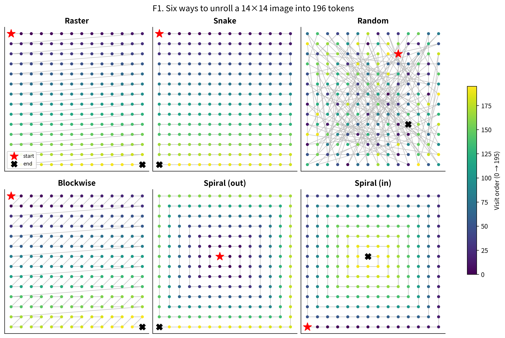

1. **왜 봤나**: 비교하는 6가지 순서가 각각 어떻게 생겼는지 먼저 보여 주려고요.
2. **어떻게 읽나**: 점 하나가 픽셀 하나예요. 색은 읽는 순서(보라=먼저, 노랑=나중), 빨간 별은 시작점, 검은 X는 끝점이에요. 회색 선은 바로 다음에 읽는 픽셀로 이어져요.
3. **무엇이 보이나**:
   - **Raster**: 책 읽듯 줄마다 왼쪽에서 오른쪽으로 읽어요. 줄이 끝나면 다음 줄 왼쪽으로 "점프"해요.
   - **Snake**: 줄마다 방향을 바꿔(지그재그) 점프가 없어요.
   - **Random**: 정해진 무작위 순서예요(모든 사진에 같은 순서).
   - **Blockwise**: 2×2 작은 블록 단위로 읽어요.
   - **Spiral (out)**: 가운데에서 시작해 바깥으로 돌아요.
   - **Spiral (in)**: Spiral (out)을 정확히 거꾸로 읽어요.
4. **그래서 무슨 뜻인가**: 같은 사진이라도 모델이 받는 "글"의 문장 순서가 완전히 달라져요.
5. **주의할 점**: Spiral (in)은 이번에 새로 추가한 통제 조건이에요. 나머지 5개가 팀의 주 비교 대상이에요.

### F2. Mamba가 한 번에 묶어 보는 칸 안에 "점프"가 있나
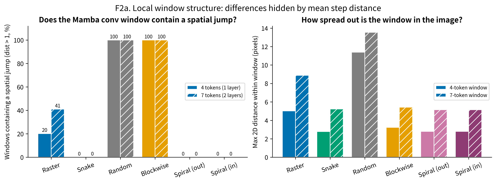
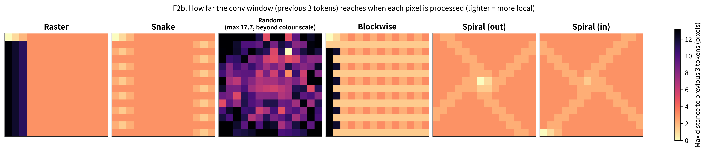
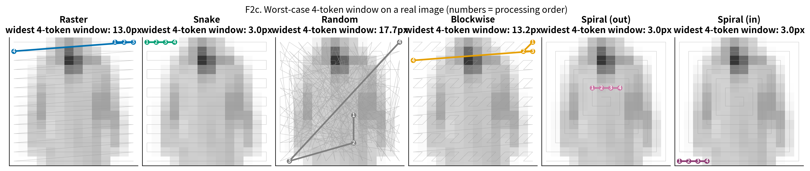

1. **왜 봤나**: 지금까지는 "평균 이동 거리"로 스캔을 비교했어요. 하지만 Mamba의 conv는 연속된 4칸(2층이면 7칸)만 직접 섞어요. 그래서 **그 작은 묶음 안에 점프가 있는지**가 더 직접적인 기준이에요.
2. **어떻게 읽나**:
   - F2a 왼쪽: 4칸(빗금 없음)·7칸(빗금) 묶음 중 점프가 섞인 묶음의 비율이에요.
   - F2a 오른쪽: 그 묶음이 원래 사진에서 얼마나 넓게 퍼져 있는지(픽셀 단위)예요.
   - F2b: 각 픽셀을 읽는 순간 직전 3칸이 사진에서 얼마나 멀리 있는지를 색으로 나타내요. 밝을수록 가까워요.
   - F2c: 실제 코트 사진 위에, 각 스캔에서 가장 넓게 퍼진 4칸 묶음을 번호로 표시했어요.
3. **무엇이 보이나**:

   | 스캔 | 점프 횟수 (195번 이동 중) | 점프가 섞인 4칸 묶음 | 7칸 묶음 | 4칸 묶음 평균 퍼짐 |
   |---|---:|---:|---:|---:|
   | Raster | 13 | 20% (39/193) | 41% | 5.0 px |
   | Snake | 0 | 0% | 0% | 2.8 px |
   | Random | 193 | 100% | 100% | 11.4 px |
   | Blockwise | 97 | **100%** | 100% | 3.2 px |
   | Spiral (out/in) | 0 | 0% | 0% | 2.8 px |

   - Raster는 왼쪽 가장자리 열만 어두워요(F2b). 줄바꿈 직후에만 묶음이 사진 반대편까지 걸쳐요.
   - Blockwise는 2×2 블록 안에서 대각선으로 한 번씩 꼭 점프해서, 묶음 전부에 점프가 있어요. 다만 점프가 짧아서 평균 퍼짐(3.2px)은 Snake(2.8px)와 비슷해요.
4. **그래서 무슨 뜻인가**: "평균 이동 거리가 짧다 = 국소적이다"라고 단정할 수 없어요. Blockwise는 평균 거리(1.56)가 Raster(1.80)보다 짧지만, Mamba의 4칸 묶음 기준으로는 모든 묶음에 점프가 있어요. 모델 성능과 비교할 때 이 지표가 평균 거리보다 더 잘 맞는지 확인할 거예요(F13).
5. **주의할 점**: 이 값은 경로만으로 정해지고 사진 내용과 무관해요. 또 Mamba의 메모장(상태)은 4칸보다 먼 과거도 기억하므로, conv 범위만으로 모델 동작을 다 설명할 수는 없어요.

### F3. Raster의 줄바꿈 점프가 픽셀값을 크게 튀게 하나 (가설 H1)
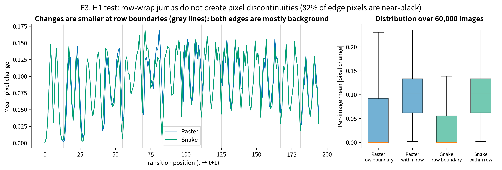

1. **왜 봤나**: 처음 가설(H1)은 "Raster는 줄바꿈마다 픽셀값이 크게 튀어서(불연속) 인공적인 14칸 주기를 만든다"였어요. 이 가설을 직접 확인했어요.
2. **어떻게 읽나**:
   - 왼쪽: 가로축은 시퀀스 위치, 세로축은 바로 다음 칸과의 밝기 차이 평균(6만 장)이에요. 회색 세로선이 줄바꿈 위치(13곳)예요.
   - 오른쪽: 사진마다 "줄바꿈에서의 평균 차이"와 "줄 안쪽에서의 평균 차이"를 낸 분포(상자그림)예요.
3. **무엇이 보이나**:
   - 줄바꿈 지점의 차이가 **오히려 더 작아요**. Raster 줄바꿈 0.054, 줄 안쪽 0.099로, 줄바꿈이 안쪽의 0.55배예요.
   - 줄바꿈에서 차이가 더 큰 사진은 34%뿐이에요.
   - 원인: 사진 양 끝 열의 82%가 거의 검은 배경이에요(밝기 0.02 미만). 오른쪽 끝(배경)에서 다음 줄 왼쪽 끝(배경)으로 점프해도 값이 거의 안 바뀌어요.
4. **그래서 무슨 뜻인가**: **H1은 픽셀값 기준으로는 지지되지 않아요.** Raster의 점프는 "공간적으로는" 멀지만(F2) "밝기로는" 거의 연속이에요. 그래서 Raster와 Snake의 차이는 픽셀값 불연속보다는 위치 정보(점프 전후 픽셀이 사진에서 멀리 떨어져 있다는 사실)에서 나올 가능성이 커요.
5. **주의할 점**: Fashion-MNIST처럼 배경이 깔끔한 데이터의 특성이에요. 배경이 복잡한 사진에서는 결과가 다를 수 있어요.

### F4. 14칸 주기성은 얼마나 강한가
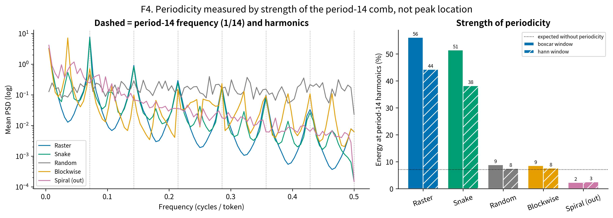

1. **왜 봤나**: 기존 분석은 "가장 높은 PSD 봉우리 위치"만 비교했어요. 그런데 봉우리 위치가 같아도(Raster·Snake·Random 모두 14) 반복의 **세기**는 전혀 다를 수 있어요.
2. **어떻게 읽나**:
   - 왼쪽: 세로축(로그)은 각 반복 간격의 세기예요. 점선은 14칸 간격과 그 배수(7칸, 4.67칸…)의 위치예요.
   - 오른쪽: 전체 에너지 중 14칸 계열 점선 위치에 몰린 비율이에요. 점선(약 7%)은 주기성이 전혀 없을 때의 기대값이에요. 빗금 없는 막대는 boxcar 창, 빗금 막대는 Hann 창으로 계산한 값이에요.
3. **무엇이 보이나**:

   | 스캔 | 14칸 계열 에너지 비율 (boxcar / Hann) | 기본 봉우리의 주변 대비 높이 |
   |---|---:|---:|
   | Raster | 56% / 44% | 213배 |
   | Snake | 51% / 38% | 99배 |
   | Random | 9% / 8% | 2.8배 |
   | Blockwise | 9% / 8% | (주 봉우리는 28칸 간격) |
   | Spiral | 2% / 3% | 0.6배 (주기 없음) |

4. **그래서 무슨 뜻인가**:
   - Raster와 Snake는 둘 다 강한 14칸 주기를 가져요. Snake는 점프가 없으니, 이 주기성의 대부분은 **옷 사진의 줄 구조**에서 와요.
   - Raster가 조금 더 강한 이유는 매 줄을 같은 방향으로 읽어 패턴이 정확히 같은 모양으로 반복되기 때문이에요(봉우리 높이 213 대 99).
   - Random의 "주기 14"는 사실상 주기성이 없는 수준이에요(9%, 기대값 7% 근처). Spiral은 주기성이 거의 없어요.
5. **주의할 점**: 팀 제안서는 Hann 창, 기존 코드는 boxcar 창을 썼어요. 두 방식 모두 순위와 결론은 같아요. 값의 크기만 조금 달라요.

### F5. 옷 종류마다 다른가
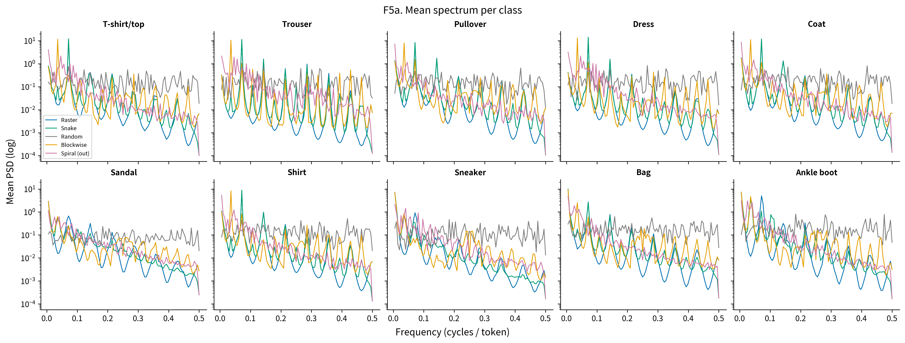
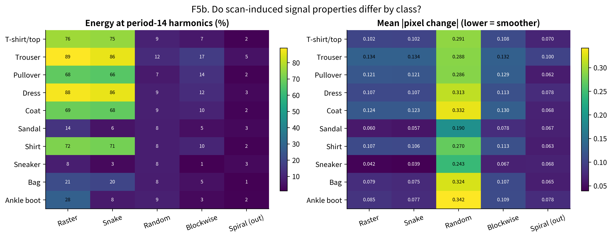

1. **왜 봤나**: 스캔의 영향이 모든 옷에 똑같은지, 특정 옷에 몰리는지 보려고요. 나중에 옷 종류별 성능(F10)과 비교할 기준이에요.
2. **어떻게 읽나**:
   - F5a: 옷 종류별로 스펙트럼을 그린 그래프예요.
   - F5b 왼쪽: 옷 종류(행) × 스캔(열)별 14칸 주기 에너지 비율이에요.
   - F5b 오른쪽: 이웃 칸 사이의 평균 밝기 차이예요(낮을수록 매끈).
3. **무엇이 보이나**:
   - 상의·바지·드레스류(T-shirt 76%, Trouser 89%, Dress 88%)는 Raster·Snake에서 14칸 주기가 매우 강해요. 세로로 긴 모양이라 모든 줄이 비슷하기 때문이에요.
   - 신발·가방(Sandal 14%, Sneaker 8%, Bag 21%)은 주기성이 약해요. 사진 아래쪽에 가로로 놓여 있어 줄마다 모양이 다르기 때문이에요.
   - **Ankle boot만 Raster(28%)와 Snake(8%)의 차이가 커요.** 왼쪽과 오른쪽 모양이 달라서(발끝 방향) 지그재그로 읽으면 반복이 깨져요.
   - Spiral은 모든 옷에서 가장 매끈해요(밝기 차이 0.06~0.10).
4. **그래서 무슨 뜻인가**: 스캔 순서가 성능에 영향을 준다면, 그 영향은 Ankle boot처럼 좌우가 비대칭인 옷이나 상의류에서 더 잘 드러날 가능성이 있어요.
5. **주의할 점**: 신호 특성 차이가 곧 성능 차이를 뜻하지는 않아요. 성능 결과와 함께 봐야 해요.

### F6. Snake와 Spiral: 똑같이 "점프 없음"인데 무엇이 다른가
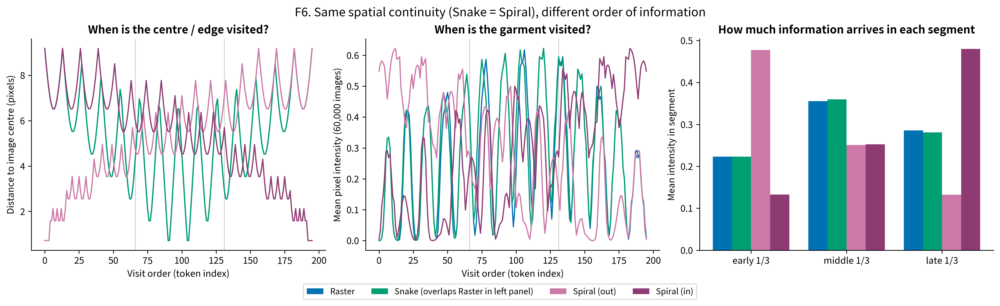

1. **왜 봤나**: Snake와 Spiral은 공간적으로 모두 이웃 픽셀만 따라가요(평균 이동 거리 1.0). 그래도 성능이 다르다면 이유는 **무엇을 언제 읽느냐**일 거예요.
2. **어떻게 읽나**:
   - 왼쪽: 읽는 순서에 따라 사진 중심에서 얼마나 떨어져 있는지예요.
   - 가운데: 그 위치의 평균 밝기예요(밝음 = 옷이 있는 부분).
   - 오른쪽: 시퀀스를 앞·중간·뒤 1/3로 나눠 각 구간의 평균 밝기를 낸 그래프예요.
3. **무엇이 보이나**:

   | 구간 | Snake | Spiral (out) | Spiral (in) |
   |---|---:|---:|---:|
   | 초기 1/3 평균 밝기 | 0.22 | **0.48** | 0.13 |
   | 중기 1/3 | 0.36 | 0.25 | 0.25 |
   | 후기 1/3 | 0.28 | 0.13 | **0.48** |

   - Spiral (out)은 처음 1/3 동안 옷의 몸통(정보가 많은 부분)을 읽고, 끝 1/3은 대부분 배경이에요.
   - Spiral (in)은 정확히 반대예요.
   - Snake는 위→아래로 고르게 읽어요.
4. **그래서 무슨 뜻인가**: Mamba는 앞에서부터 메모장에 요약하며 읽기 때문에, 중요한 정보가 **앞에 오느냐 뒤에 오느냐**가 학습에 영향을 줄 수 있어요. Spiral (out)과 (in)은 F2~F4의 신호 지표가 **완전히 같아서**(밝기 차이 0.0720 동일, PSD 차이 10⁻⁹ 수준) 이 효과만 따로 시험할 수 있는 깨끗한 비교예요(F15).
5. **주의할 점**: 이 모델은 마지막 칸 하나가 아니라 **모든 칸의 출력을 평균**해서 분류해요. 그래서 "마지막에 본 것을 더 잘 기억한다" 같은 단순한 설명은 맞지 않아요. 차이가 난다면 "앞에서 읽은 내용이 뒤 칸들의 해석을 어떻게 바꾸느냐"의 문제예요.

---

## 3. 분류 성능 결과

> 진행 상황: Mamba 5개 스캔(예림, 저장소에 공개된 체크포인트) · Mamba Spiral (in)(지효) · 1D CNN 6개 스캔이 모두 끝났어요. d_conv ablation(F14)은 효정 결과를 기다리는 중이에요.
> Mamba 체크포인트 15개는 해시값(SHA-256)과 공개된 점수가 모두 일치하는 것을 확인했고, 다시 예측한 결과도 저장된 점수와 일치했어요.

### 비교 기준선: 1D CNN은 어떤 모델인가
- 층이 2개인 작은 합성곱 모델이에요(파라미터 5,674개, Mamba의 약 1/4).
- 한 번에 9칸만 보고, 위치 정보 없이 196칸 출력을 **평균**해서 분류해요.
- 비유하면 "글을 읽지 않고, 어떤 단어 조각들이 나왔는지 세는 모델"에 가까워요.
- 학습 설정은 Mamba와 똑같아요(20 epoch, 같은 분할, 같은 seed).

### F7·F8. 스캔별 성능 (Mamba vs CNN)
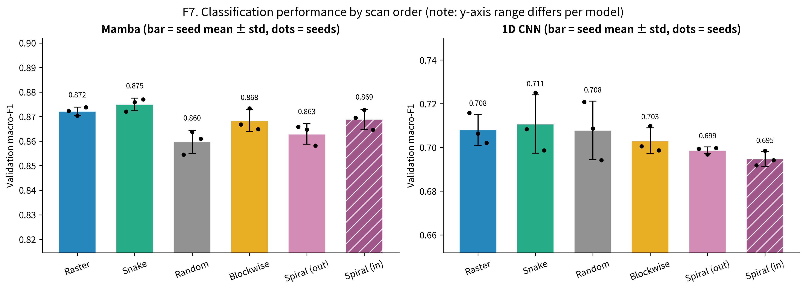
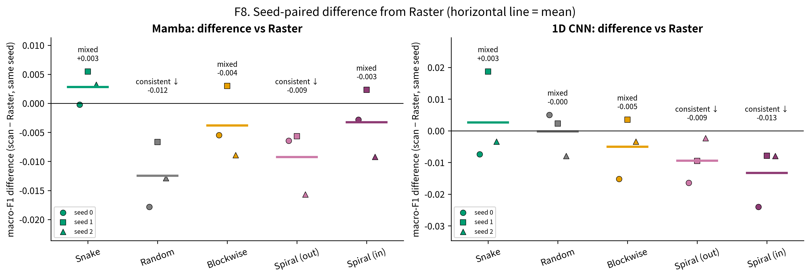
1. **왜 봤나**: 스캔 순서가 분류 성능을 바꾸는지, 그리고 그 효과가 Mamba에만 있는지가 이 연구의 핵심 질문이에요.
2. **어떻게 읽나**:
   - F7: 막대는 seed 3개의 평균, 검은 점은 각 seed, 세로선은 표준편차예요. **두 모델의 세로축 범위가 달라요**(Mamba 약 0.87, CNN 약 0.71).
   - F8: **같은 seed끼리 짝지어** Raster와의 차이를 그렸어요. 0보다 위면 Raster보다 좋은 거예요. 가로선은 평균이고, "consistent"는 seed 3개 모두 같은 방향이라는 뜻이에요.
3. **무엇이 보이나** (검증 macro-F1):

   | 스캔 | Mamba | Mamba, Raster 대비 | CNN | CNN, Raster 대비 |
   |---|---:|---|---:|---|
   | Raster | 0.872 ± 0.002 | 기준 | 0.708 ± 0.007 | 기준 |
   | Snake | **0.875 ± 0.003** | +0.003, 엇갈림 (2/3) | 0.711 ± 0.013 | +0.003, 엇갈림 |
   | Random | **0.860 ± 0.005** | **−0.012, seed 3개 모두 낮음** | 0.708 ± 0.013 | 0.000, 엇갈림 |
   | Blockwise | 0.868 ± 0.004 | −0.004, 엇갈림 (1/3) | 0.703 ± 0.006 | −0.005, 엇갈림 |
   | Spiral (out) | 0.863 ± 0.004 | **−0.009, seed 3개 모두 낮음** | 0.699 ± 0.002 | −0.009, seed 3개 모두 낮음 |
   | Spiral (in) | 0.869 ± 0.004 | −0.003, 엇갈림 (1/3) | 0.695 ± 0.003 | −0.013, seed 3개 모두 낮음 |

   - Mamba가 CNN보다 훨씬 잘해요(0.87 대 0.71). 파라미터도 약 4배 많아요.
   - **Random은 Mamba에서만 확실히 나빠져요**(seed 3개 모두 −0.012). 같은 Random이 CNN에서는 Raster와 같은 점수예요.
   - Spiral (out)은 Mamba와 CNN **둘 다** 약 0.009 낮아요.
   - 스캔 간 최대 격차(주 실험 5개 스캔)는 Mamba 0.015, CNN 0.012로 비슷해요. 하지만 seed 간 흔들림이 Mamba(평균 표준편차 0.0035)가 CNN(0.0083)보다 훨씬 작아요. 그래서 격차를 흔들림으로 나누면 Mamba 약 4.4배, CNN 약 1.5배예요. **Mamba의 순서 차이가 더 또렷해요.**
4. **그래서 무슨 뜻인가**:
   - 사진을 **완전히 뒤섞으면(Random) Mamba만 손해를 봐요.** Mamba는 순서대로 읽으며 기억을 쌓기 때문에, 이웃 픽셀이 목록에서 흩어지면 공간 구조를 쓰기 어려워요. CNN은 "조각 세기"라서 순서가 섞여도 상관없어요.
   - Spiral (out)의 손해는 두 모델에서 같으니, Mamba만의 성질이라고 보기 어려워요.
   - 나머지 스캔(Snake, Blockwise, Spiral (in))은 Raster와 차이가 seed마다 엇갈려요. 이 정도 차이는 seed 3개로 구분할 수 없어요.
5. **주의할 점**:
   - seed가 3개뿐이에요. "seed 3개 모두 같은 방향"은 통계적 유의성이 아니에요.
   - Raster seed 0·1은 다른 서버(RTX 4090, PyTorch 2.9)에서 학습됐어요. 나머지는 RTX PRO 6000(PyTorch 2.13)에서 학습됐어요(예림 README).
   - Spiral (in)은 다른 사람이 같은 설정으로 따로 학습했어요(설정 일치 확인).
   - CNN 쪽 한계(덜 학습됨, 작은 모델)는 아래 F7b에 있어요.

### F7b. (보조 실험) CNN을 더 오래 학습하면
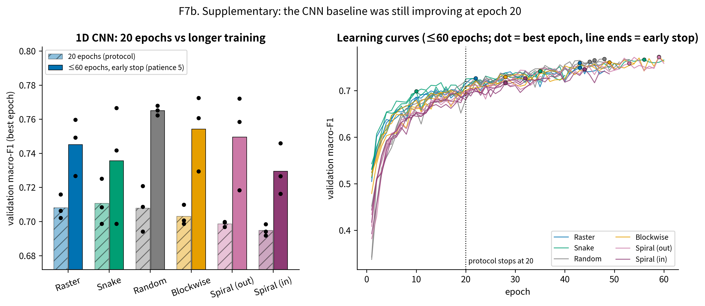
1. **왜 봤나**: 20 epoch CNN이 아직 덜 학습된 상태였어요. 그래서 "CNN은 순서에 둔감하다"는 결론이 단지 덜 배워서 생긴 건지 확인하려고 했어요.
2. **어떻게 읽나**:
   - 왼쪽: 빗금 막대는 20 epoch(프로토콜), 진한 막대는 최대 60 epoch예요. 60 epoch 실행은 검증 점수가 5 epoch 연속 오르지 않으면 멈춰요(early stopping). 점은 각 seed예요.
   - 오른쪽: 60 epoch 실행의 학습 곡선이에요. 동그라미는 최고 점수 epoch이고, 선이 끝난 곳이 멈춘 곳이에요. 점선은 프로토콜이 멈추는 20 epoch예요.
3. **무엇이 보이나**:

   | 스캔 | 20 epoch | 최대 60 epoch | 향상 | Raster 대비 (60 epoch, 같은 seed) | 멈춘 epoch |
   |---|---:|---:|---:|---|---|
   | Raster | 0.708 | 0.745 ± 0.017 | +0.037 | 기준 | 27, 48, 48 |
   | Snake | 0.711 | 0.736 ± 0.034 | +0.025 | −0.010, 엇갈림 | 40, 60, **15** |
   | Random | 0.708 | **0.765 ± 0.003** | +0.057 | +0.020, seed 3개 모두 높음 | 50, 53, 51 |
   | Blockwise | 0.703 | 0.754 ± 0.022 | +0.051 | +0.009, 엇갈림 | 54, 33, 60 |
   | Spiral (out) | 0.699 | 0.750 ± 0.028 | +0.051 | +0.004, 엇갈림 | 33, 58, 60 |
   | Spiral (in) | 0.695 | 0.730 ± 0.015 | +0.035 | −0.016, seed 3개 모두 낮음 | 33, 49, 37 |

   - 모든 스캔이 0.03~0.06 올랐어요. 20 epoch에서는 확실히 덜 학습된 상태였어요.
   - 오른쪽 학습 곡선들은 스캔과 상관없이 **거의 겹쳐서** 올라가요.
   - 그런데 seed 간 차이(표준편차)는 20 epoch(0.002~0.013)보다 커졌어요(0.003~0.034). **언제 멈췄느냐**가 seed마다 크게 달랐기 때문이에요. 예를 들어 Snake seed 2는 15 epoch에서 멈췄어요. 20 epoch 실행보다도 일찍 멈춘 거예요.
   - 18개 중 5개는 59~60 epoch에서 최고 점수가 나왔어요. 60 epoch로도 다 수렴하지 않은 실행이 있다는 뜻이에요.
4. **그래서 무슨 뜻인가**:
   - CNN이 덜 학습된 것은 사실이에요. 그래도 **스캔 간 차이가 seed 간 차이보다 크지 않다**는 큰 그림은 그대로예요.
   - Random이 seed 3개 모두에서 Raster보다 높게 나왔어요. 하지만 Random seed들은 50 epoch 넘게 학습했고 Raster seed 하나는 27 epoch에서 멈췄어요. 그래서 이 차이가 스캔 때문인지, 학습한 길이 때문인지 구분할 수 없어요.
5. **주의할 점**:
   - 이 실험은 프로토콜(20 epoch)과 설정이 달라서 **보조 자료**예요. 주 비교(Mamba vs CNN)는 20 epoch 결과로 해요.
   - "5 epoch 연속 개선 없음" 기준은 이 CNN처럼 검증 점수가 들쭉날쭉한 모델에는 짧았어요. 그래서 일부 실행이 일찍 멈췄어요.
   - 최고 epoch를 검증 점수로 고르고 그 점수를 보고하기 때문에 점수가 약간 후하게 나와요. 모든 조건에 똑같이 적용돼요.

### F15. 같은 경로를 반대로 읽으면 (Spiral out vs in)
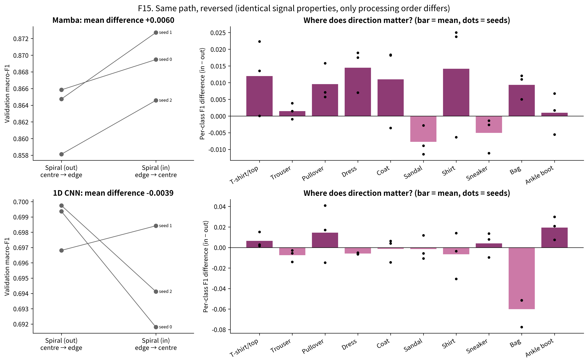
1. **왜 봤나**: Spiral (out)과 (in)은 완전히 같은 경로를 반대 방향으로 읽어요. 그래서 점프 비율, 픽셀 변화량, PSD 같은 **신호 지표가 모두 똑같아요**(F2~F4). 성능이 다르면 그건 오로지 "무엇을 먼저 읽느냐" 때문이에요.
2. **어떻게 읽나**:
   - 왼쪽: seed별로 (out)→(in) 점수를 선으로 이었어요. 선이 올라가면 (in)이 더 좋은 거예요.
   - 오른쪽: 옷 종류별 차이((in) − (out))예요. 막대는 평균, 점은 seed예요.
3. **무엇이 보이나**:
   - **Mamba: (in)이 seed 3개 모두에서 더 좋아요**(평균 +0.006, 0.863 → 0.869).
     - 좋아진 종류: 상의류(T-shirt +0.012, Dress +0.014, Shirt +0.014, Coat +0.011, Pullover +0.010)와 Bag(+0.009)
     - 조금 나빠진 종류: 신발류(Sandal −0.008, Sneaker −0.005)
   - **CNN: 방향 효과가 없어요**(평균 −0.004, seed 3개 중 1개만 (in)이 좋음).
4. **그래서 무슨 뜻인가**:
   - 신호가 똑같은데 Mamba에서만 seed 3개 모두 같은 방향의 차이가 났어요. **처리 순서 자체가 Mamba에 영향을 준다**는 가장 깨끗한 증거예요.
   - (in)은 가장자리(배경, 옷 윤곽)부터 읽고 옷 가운데를 마지막에 읽어요. Mamba는 앞에서 쌓은 기억으로 뒤를 해석하니까, 윤곽을 먼저 보고 안쪽을 해석하는 쪽이 상의류 구분에 유리했던 것으로 보여요.
   - (in)은 Raster와의 차이도 엇갈림(−0.003)으로 거의 같아졌어요. 그러니까 Spiral (out)이 낮은 건 "나선 경로"가 나빠서가 아니라 **가운데부터 읽는 방향** 때문일 가능성이 커요. 단, CNN에서도 (out)이 낮았던 점은 함께 고려해야 해요.
5. **주의할 점**:
   - 차이(0.006)가 seed 간 표준편차(0.004)와 비슷한 크기예요.
   - Mamba (out)은 예림 서버, (in)은 지효 서버에서 학습됐어요. PyTorch 버전은 같지만(2.13) GPU가 달라요.
   - 왜 (in)이 유리한지는 아직 가설이에요.

### F9. 학습 곡선
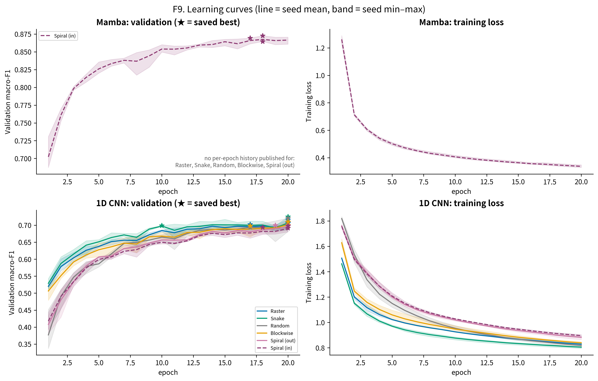
- 예림이 공개한 Mamba 5개 스캔은 **epoch별 기록(history.json)이 저장소에 없어서** 곡선을 그릴 수 없었어요. 그래서 Mamba는 Spiral (in)만 그렸어요. 필요하면 예림에게 받아야 해요.
- **Mamba Spiral (in)**: 10 epoch 이후 0.85~0.87에서 평평해져요. 최고 epoch는 17, 18, 18이에요. 거의 다 학습된 상태예요.
- **CNN**: 20 epoch까지도 계속 오르는 중이에요(덜 학습됨, F7b).

### F10. 어떤 옷 종류가 스캔 순서의 영향을 받나 (Mamba)
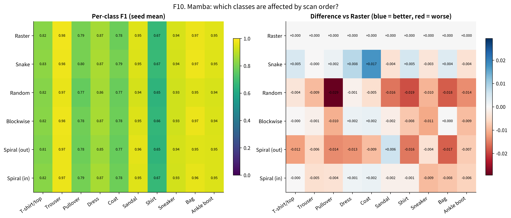
1. **왜 봤나**: 평균 점수 차이가 특정 옷 종류에서 오는지 보려고요.
2. **어떻게 읽나**: 왼쪽은 스캔 × 옷 종류별 F1이에요. 오른쪽은 Raster와의 차이예요(파랑 = 더 좋음, 빨강 = 더 나쁨). seed 3개 평균이에요.
3. **무엇이 보이나**:
   - 어느 스캔이든 **Shirt(0.65~0.67), Coat, Pullover(0.77~0.80)가 가장 어려워요.** 위에 입는 옷끼리 헷갈리는 거예요.
   - **Random**: 거의 모든 종류가 나빠져요. 특히 Pullover(−0.029), Shirt(−0.019), Bag(−0.018), Sandal(−0.016)이에요.
   - **Spiral (out)**: Bag(−0.017), Shirt(−0.016), Pullover(−0.014), Dress(−0.013), T-shirt(−0.012)가 나빠지고, Sandal만 조금 좋아져요(+0.006).
   - **Snake**: Coat가 조금 좋아져요(+0.017).
4. **그래서 무슨 뜻인가**: 스캔 순서의 영향은 **원래 헷갈리는 상의류에서 가장 크게** 나타나요. 미세한 모양 차이(목 부분, 소매 길이)를 구분해야 하는 종류라서, 읽는 순서에 따라 공간 정보를 얼마나 잘 모으느냐가 중요한 것으로 보여요.
5. **주의할 점**: 클래스별 F1은 클래스당 약 1,200장이라 ±0.01 정도는 흔들릴 수 있어요. CNN 버전은 `figures/F10_per_class_f1_cnn.png`에 있어요.

### F11. 무엇을 무엇으로 헷갈리나 (Mamba, Raster vs Spiral (out))
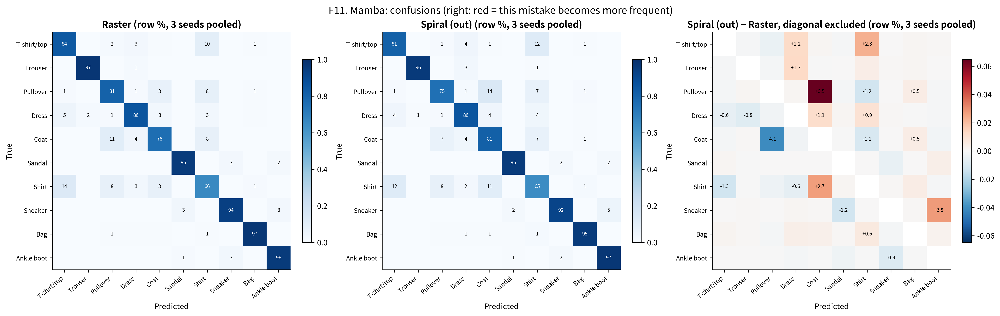
1. **어떻게 읽나**:
   - 왼쪽·가운데: 혼동 행렬이에요. 행이 정답, 열이 예측이고, 각 행에서 몇 %가 어디로 갔는지 보여요.
   - 오른쪽: Spiral (out) − Raster예요. 빨강은 그 실수가 늘어난 곳이에요(대각선 제외, %p).
2. **무엇이 보이나**:
   - Spiral (out)은 **Pullover를 Coat로 착각하는 비율이 6.5%p 늘고**, 반대로 Coat를 Pullover로 착각하는 비율은 4.1%p 줄어요. Pullover와 Coat의 경계가 Coat 쪽으로 옮겨 간 거예요.
   - 그 밖에 늘어난 실수: Sneaker→Ankle boot +2.8%p, Shirt→Coat +2.7%p, T-shirt→Shirt +2.3%p
3. **그래서 무슨 뜻인가**: 스캔이 바뀌면 단순히 "전체적으로 더 틀리는" 게 아니라 **비슷한 종류 사이의 판단 기준이 이동**해요. Coat와 Pullover는 앞 지퍼나 단추 같은 옷 **가운데의 세로선**으로 구분돼요. Spiral (out)은 이 가운데 부분을 맨 처음에 읽어요.

### F12. 스캔을 바꾸면 예측이 바뀌는 이미지 (Mamba)
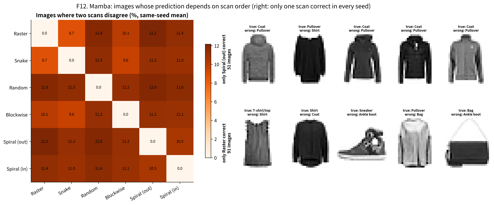
1. **어떻게 읽나**:
   - 왼쪽: 두 스캔이 **서로 다른 답**을 낸 이미지의 비율이에요(같은 seed끼리 비교해 평균).
   - 오른쪽: seed 3개 모두에서 **한 스캔만 맞힌** 이미지 예시예요.
2. **무엇이 보이나**:
   - 정확도가 거의 같아도 **스캔끼리 약 9~12%의 이미지에서 답이 달라요.**
   - Raster–Snake가 8.7%로 가장 비슷하고, Raster–Spiral (out)이 12.2%로 가장 달라요.
   - seed 3개 모두에서 Spiral (out)만 맞힌 이미지가 51장, Raster만 맞힌 이미지가 91장이에요. 대부분 Coat/Pullover/Shirt예요.
3. **그래서 무슨 뜻인가**:
   - 평균 점수 차이(약 1%)보다 **실제로 바뀌는 판단이 훨씬 많아요.** 스캔마다 맞히는 이미지와 틀리는 이미지가 서로 달라요.
   - Raster와 Snake가 가장 비슷한 건 자연스러워요. 둘 다 한 줄씩 읽는 방식이고, 차이는 짝수 줄 방향뿐이에요.
4. **주의할 점**: seed만 바꿔도 같은 스캔 안에서 답이 바뀌는 이미지가 있어요. 그래서 9~12%가 모두 스캔 효과는 아니에요.

### F13. 신호 특성으로 성능을 설명할 수 있나
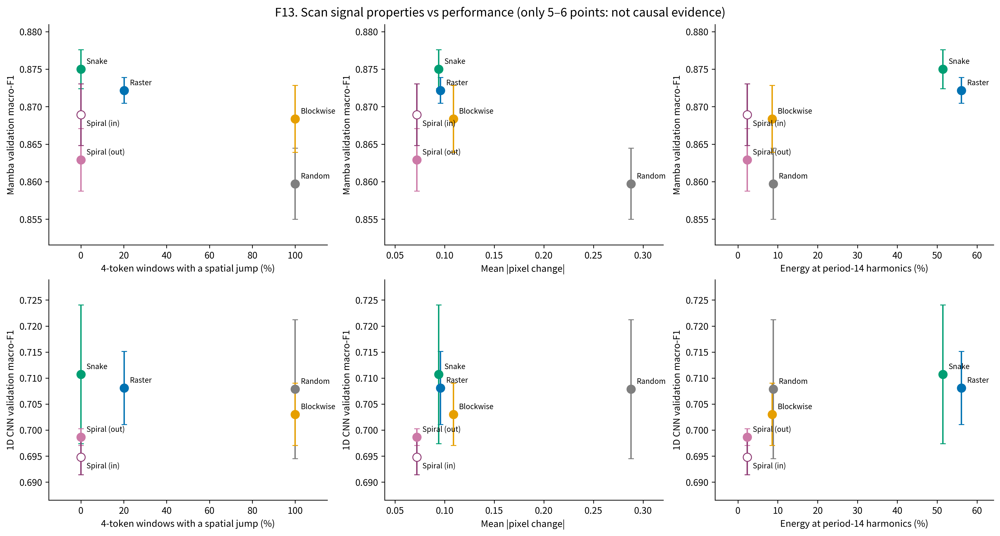
1. **어떻게 읽나**:
   - 가로축은 2장의 신호 지표 세 가지예요: 4칸 묶음 중 점프가 섞인 비율, 평균 픽셀 변화량, 14칸 주기 에너지.
   - 세로축은 성능이고, 위 줄이 Mamba, 아래 줄이 CNN이에요.
   - 속이 빈 점이 Spiral (in)이에요.
2. **무엇이 보이나**:
   - **Random**은 점프 100%, 픽셀 변화 0.29로 가장 크고, Mamba 성능도 가장 낮아요.
   - 하지만 **Blockwise도 점프 100%인데** Mamba 성능은 중간(0.868)이에요.
   - **Spiral (out)은 점프 0%, 픽셀 변화 최소인데** 성능이 낮은 편이에요.
   - **Spiral (out)과 (in)은 가로 위치가 완전히 같은데** 성능이 달라요.
   - CNN은 어떤 지표와도 뚜렷한 관계가 없어요.
3. **그래서 무슨 뜻인가**: 신호 지표 하나로는 Mamba 성능 순서를 설명할 수 없어요. "점프가 적고 매끄러울수록 좋다"는 단순한 규칙은 맞지 않아요. **읽는 방향과 정보가 들어오는 순서**(F6, F15)도 함께 작용해요.
4. **주의할 점**: 점이 5~6개뿐이라 인과관계를 말할 수 없어요.

---

## 4. 가설 판정표

| 가설 | 판정 기준 (분석 전에 고정) | 판정 |
|---|---|---|
| **H1** Raster 줄바꿈이 픽셀값 불연속을 만든다 | 줄바꿈 차이 > 줄 안쪽 차이, 그리고 14칸 봉우리가 Snake보다 강함 | **기각(픽셀값 기준)**: 줄바꿈 차이가 오히려 작음(0.55배). 봉우리는 Raster가 더 강하지만, 원인은 반복 방향이 같아서임 |
| 스캔 순서가 성능에 일관된 영향을 준다 | seed 3개 모두에서 Raster 대비 차이의 부호가 같음 | **부분 지지**: Mamba에서 Random(−0.012)과 Spiral (out)(−0.009)이 seed 3개 모두 낮음. Snake, Blockwise, Spiral (in)은 엇갈림 |
| 그 영향은 Mamba에서 더 크다 | Mamba의 스캔 간 격차 > CNN의 격차 | **부분 지지**: 격차 크기는 비슷함(0.015 대 0.012). 하지만 seed 흔들림 대비 Mamba가 약 3배 또렷하고, Random 손해는 Mamba에만 있음. Spiral (out) 손해는 두 모델 공통 |
| 처리 순서 자체가 중요하다 (Spiral out vs in) | 신호 지표는 동일하므로, seed 3개 모두에서 같은 방향의 성능 차이가 나면 지지 | **지지(약함)**: Mamba는 (in)이 seed 3개 모두 높음(+0.006). CNN은 엇갈림. 단, 효과 크기가 seed 표준편차와 비슷함 |
| 모델이 공간 점프 직후 기억을 리셋한다 (F16b, 추가 확인) | 배경→배경 이동에서 점프 직후 Δ > 이웃 이동 Δ (Raster, Blockwise 모두) | **지지 안 됨**: Raster +0.017, Blockwise −0.023으로 방향이 반대. 모델은 점프보다 내용(배경/옷)에 반응 |
| 국소 conv가 스캔 민감도를 만든다 | d_conv=1에서 스캔 간 격차가 줄어듦 | 효정 결과 대기 (F14) |

---

## 5. 재현 방법

```bash
# 저장소 루트에서. torch·scipy·sklearn·matplotlib가 설치된 파이썬 환경을 쓴다.
PY=python   # 다른 환경이면 그 환경의 python 경로로 바꾼다
cd mamba_starter
$PY t5_concept_figure.py                       # 1.5장: 도식 F0, F0b
$PY t5_delta_analysis.py                       # 1.5장: 학습된 Δ와 커널 (F16a, F16b, F17), 약 1분
$PY t5_local_analysis.py                       # 2장: 신호 분석 (F1~F6), 약 1.5분
bash ../phase2_t5/run_t5_extra.sh cnn          # 1D CNN 6개 스캔 × seed 3개 (CPU)
bash ../phase2_t5/run_t5_extra.sh cnn60        # (보조) CNN 최대 60 epoch, 5 epoch 개선 없으면 중단 (CPU, 약 25분)
$PY t5_cnn_epochs.py                           # F7b: CNN 20 vs 60 epoch
bash ../phase2_t5/run_t5_extra.sh inward       # Mamba Spiral (in) seed 3개 (GPU)
$PY import_t5_checkpoints.py                   # 공개된 Mamba 체크포인트(phase2_t5/checkpoints)를 해시·점수 확인 후 분석용 폴더로 연결
bash ../phase2_t5/run_on_checkpoints.sh --once # 설정 확인 + 예측 저장 + F7~F17 생성
```

- 신호 분석 수치: `phase2_t5/results/train-local/` (`checks.json`에 HANDOFF 표와 4칸 묶음 수치를 재현한 검증값이 있어요)
- 모델 성능 표: `phase2_t5/results/model-validation/`
